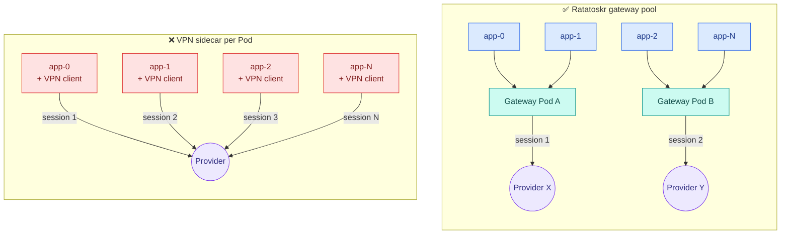
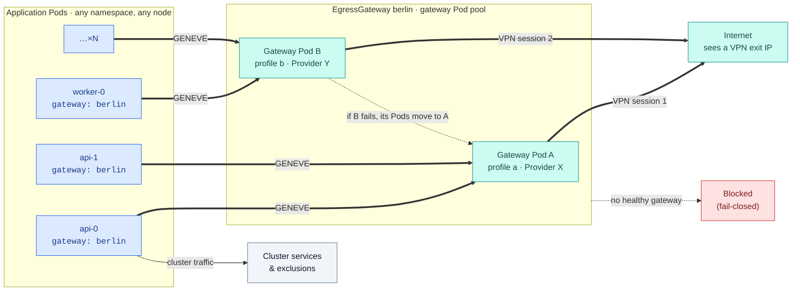

<p align="center">
  
</p>

<p align="center">
  
</p>

<h1 align="center">Ratatoskr</h1>

<p align="center">
  <strong>Kubernetes egress, through the VPN you choose.</strong><br>
  A few gateway Pods hold the VPN connections. Every other Pod routes through them.<br>
  Share VPN accounts, fail over between providers, and never leak.
</p>

<p align="center">
  <a href="LICENSE"></a>
  
  
  
</p>

---

## What is Ratatoskr?

Ratatoskr is a Kubernetes operator that **routes traffic from your application
Pods through dedicated gateway Pods**, and only the gateway Pods hold VPN
connections.

You declare an `EgressGateway`, say `berlin`, backed by one or more VPN
profiles. Ratatoskr runs a small pool of **gateway Pods**, one per profile, each
holding its own VPN tunnel. Any Pod in the cluster labelled
`ratatoskr.skaldhall.io/gateway: berlin` then has its outbound traffic tunnelled
over the cluster network to one of those gateway Pods, and from there out
through the VPN.

```yaml
# This is all an application needs:
metadata:
  labels:
    ratatoskr.skaldhall.io/gateway: berlin
```

As a result:

- **Hundreds of Pods share a handful of VPN sessions.** You pay for, and stay
  within the connection limits of, a few VPN accounts, not one per replica.
- **Gateways can mix accounts and providers.** If one profile's tunnel fails,
  its client Pods move to a healthy gateway Pod automatically.
- **Your applications stay unchanged.** No VPN client, no `NET_ADMIN`, no TUN
  device, no sidecar.
- **Nothing leaks.** If no healthy gateway or tunnel is available, selected
  traffic is blocked. It never falls back to the node's own IP.

## Why not just a VPN sidecar?

Putting an OpenVPN or WireGuard sidecar next to your app works for one Pod. It
stops working once you scale, because **every replica opens its own VPN
session**.



*Left: N replicas mean N VPN sessions, N `NET_ADMIN` Pods and one provider.
Right: N replicas share 2 sessions across 2 providers, and the app Pods need no
privileges.*

| | VPN sidecar in every Pod | Ratatoskr gateway pool |
| --- | --- | --- |
| **VPN sessions** | One per application replica. 50 replicas means 50 concurrent sessions. | One per gateway Pod, **shared by all** opted-in Pods. |
| **Provider accounts and licences** | Most providers cap concurrent connections per account, so you need more accounts as you scale. | A few accounts serve the whole cluster. Up to 8 independent profiles per gateway. |
| **Failover** | Tied to one config. When that account or provider is down, the Pod is down. | A gateway pool can mix accounts and **providers**. Pods on a failed endpoint move to a healthy one (agent driver). |
| **Application privileges** | Every app Pod needs `NET_ADMIN` and `/dev/net/tun`. | App Pods need nothing. Only the gateway and the node agent are privileged. |
| **Leak protection** | Depends on each sidecar's kill switch and start-up ordering. | Fail-closed, enforced by the node agent and the gateway. |
| **Changing the exit** | Edit and redeploy every workload's sidecar config. | Change one gateway, or one label. |
| **Split tunnelling** | Configured per app, if the client supports it. | `EgressPolicy` by CIDR, port or domain name. |
| **Visibility** | Scattered across sidecar logs. | One dashboard: gateway health, traffic, connections, exit location. |

> **Good to know:** balancing is **per Pod**, not per connection. Each client Pod
> keeps one gateway endpoint (and therefore one exit IP) while that endpoint is
> healthy. Failover changes the exit IP, and open connections may break. If the
> exit location matters, put only same-region profiles in one gateway.

> In Norse myth, Ratatoskr is the squirrel that runs up and down the world tree
> Yggdrasil, carrying messages between worlds. This project does the same for
> your Pods' packets.

## Use cases

| You need to… | With Ratatoskr |
| --- | --- |
| **Run many replicas behind a VPN without buying an account per replica** | Many Pods share a few gateway Pods. You size VPN accounts by gateways, not by replicas. |
| **Keep egress up when one VPN account or provider fails** | Put profiles from different accounts or providers into one gateway. Pods on a failed endpoint move to a healthy one. |
| **Reach the internet from a specific country or region**: geo-restricted APIs, localized content testing, region-specific scraping or monitoring | One gateway per exit location (`berlin`, `warsaw`, `nyc`). Each workload picks its exit with a label. |
| **Present a stable, known egress IP** to partners that allowlist source addresses | Route only that partner's CIDR through a gateway with an `EgressPolicy`. Everything else keeps its normal path. |
| **Reach a remote or partner network** that is only available over VPN | Point the gateway at the partner's OpenVPN profile. Opted-in workloads reach it as if they were on the VPN. |
| **Guarantee that traffic never leaves from the cluster's own IP**: security testing, OSINT, privacy-sensitive jobs | Fail-closed by design. With no healthy gateway or tunnel, selected traffic is dropped, not leaked. |
| **Stop embedding VPN clients in application containers** | Apps need no `NET_ADMIN`, no TUN device and no sidecar. A node agent programs the routing for them. |
| **Split-tunnel by domain**, e.g. send the API through the VPN but download from the CDN directly | DNS-aware `EgressPolicy` rules (`matchName` / `matchPattern`) with the gateway DNS resolver. |
| **Give different teams different exits** in one cluster | Gateways allowlist namespaces with a label selector, so a team uses only the gateways it is authorized for. |

**Ratatoskr is not** a general-purpose egress firewall, a service mesh, or a way
to give Pods inbound connectivity through a VPN. It controls **outbound** IPv4
traffic from selected Pods.

## How it works



*N application Pods share 2 VPN sessions. Each client Pod is pinned to one
healthy gateway Pod, so its exit IP stays stable.*

1. **You declare intent.** An `EgressGateway` lists one or more VPN profiles
   and the namespaces allowed to use them. An optional `EgressPolicy` says
   *which* destinations go through it.
2. **The operator builds the gateway pool.** The controller runs one gateway Pod
   per profile. Each gateway Pod has Ratatoskr's datapath container and an
   OpenVPN container that share a network namespace, and it holds exactly one
   VPN session.
3. **Admission marks the workload.** When a labelled Pod is created, the
   admission webhook checks that its namespace is allowed to use the gateway and
   injects the configuration the Pod needs.
4. **The node agent wires the Pod to a gateway Pod.** A DaemonSet programs the
   Pod's network namespace. Selected traffic is encapsulated (GENEVE) and sent
   over the cluster network to **one** healthy gateway Pod, chosen by
   rendezvous hashing so that the choice stays stable. You can optionally wrap
   that leg in WireGuard.
5. **The gateway forwards, fails over, or blocks.** The gateway Pod applies
   policy checks and a kill switch, SNATs the traffic, and sends it into its VPN
   tunnel. If that gateway Pod becomes unhealthy, the agent moves its client
   Pods to another healthy one. If none are left, the traffic is dropped.

### Building blocks

| Component | What it does |
| --- | --- |
| `EgressGateway` (CRD) | A VPN exit: upstream profile(s), replicas, DNS mode, in-cluster encryption, and which namespaces may use it. |
| `EgressPolicy` (CRD) | Optional, namespaced. Narrows routing to specific CIDRs, ports or DNS names (`include`), or tunnels everything *except* them (`exclude`). |
| Controller | Reconciles gateways, manages gateway Pods, and reports readiness and health. |
| Admission webhook | Authorizes and prepares opted-in Pods at creation time. |
| Node agent (DaemonSet) | Programs and maintains routing inside each selected Pod's network namespace. |
| Gateway Pod | The proxy that client Pods route through. Runs the datapath (GENEVE ingress, policy, kill switch, SNAT) plus an OpenVPN container holding one VPN session. One Pod per profile. |

The full architecture, routing semantics and design decisions are in the
[architecture guide](docs/design.md) and the [ADRs](docs/adr/).

## Getting started

This walkthrough takes about 10 minutes. At the end, one test Pod reaches the
internet through your VPN and an ordinary Pod does not.

### Prerequisites

- Kubernetes **1.29+** with Linux worker nodes
- Helm 3 (OCI support) and `kubectl`, with permission to install CRDs, cluster
  RBAC, admission webhooks and a DaemonSet
- Nodes with **GENEVE, nftables and TUN** support (and WireGuard, if you enable
  in-cluster encryption)
- An **OpenVPN profile** (`.ovpn`) from your VPN provider or remote network, plus
  credentials if it needs them

> **Security note:** the node agent uses host PID and the container runtime (CRI)
> socket, so treat it as **node-root-equivalent** and run it only on trusted
> nodes. Gateway Pods need network capabilities and `/dev/net/tun`. Your
> application Pods get **no** extra privileges. See the
> [chart security model](charts/ratatoskr/README.md).

### 1. Install the operator

Create `ratatoskr-values.yaml` and **adjust it to your cluster**:

```yaml
driver: agent        # node agent maintains Pod routing (recommended)
datapath: iproute    # Linux policy routing; `ebpf` is opt-in

agent:
  # containerd default. For k3s/k3d use /run/k3s/containerd/containerd.sock
  criSocket: /run/containerd/containerd.sock

exclusions:
  # Your cluster's Service CIDR(s). Traffic here never enters the VPN.
  serviceCIDRs:
    - 10.96.0.0/12
  # Usually auto-discovered from Nodes; set explicitly if your CNI hides them.
  podCIDRs: []
```

> Do not copy the Service CIDR blindly. Exclusions bypass the VPN, so a range
> that is too broad quietly un-protects traffic.

Pick a version from the [releases page](https://github.com/jradikk/ratatoskr/releases).
The example below uses the latest release at the time of writing.

```sh
export RATATOSKR_VERSION=0.4.2

helm upgrade --install ratatoskr oci://ghcr.io/jradikk/charts/ratatoskr \
  --version "$RATATOSKR_VERSION" \
  --namespace ratatoskr-system --create-namespace \
  --values ratatoskr-values.yaml \
  --wait --timeout 5m

kubectl get pods -n ratatoskr-system
```

You should see the controller, the webhook, and one agent Pod per node in the
`Running` state. All chart options are in
[values.yaml](charts/ratatoskr/values.yaml).

### 2. Store your VPN profile in a Secret

```sh
kubectl create secret generic berlin-vpn \
  --namespace ratatoskr-system \
  --from-file=client.ovpn=/path/to/client.ovpn
  # add --from-file=auth.txt=/path/to/auth.txt for username/password auth
```

`auth.txt` holds the username and password on separate lines. Prefer a profile
with inline certificates; otherwise add each referenced cert/key file to the
same Secret under its expected filename. See the
[OpenVPN upstream guide](plugins/upstream/openvpn/README.md).

> Keep VPN profiles and credentials **out of Git and Helm values**. The gateway
> only references the Secret by name.

### 3. Create a gateway

```yaml
# gateway.yaml
apiVersion: ratatoskr.skaldhall.io/v1alpha1
kind: EgressGateway
metadata:
  name: berlin
  namespace: ratatoskr-system
spec:
  replicas: 1
  upstream:
    type: openvpn
    secretRef:
      name: berlin-vpn
  encryption: none      # in-cluster leg only; the VPN tunnel is always used
  failMode: closed
  dns:
    mode: cluster       # `gateway` = resolve external names through the VPN
  allowedNamespaces:    # who may use this gateway
    namespaceSelector:
      matchLabels:
        ratatoskr-access: berlin
```

```sh
kubectl apply -f gateway.yaml
kubectl wait --for=condition=Ready egressgateway/berlin \
  -n ratatoskr-system --timeout=180s
```

`allowedNamespaces` is an allowlist. If you omit the selector, no namespace has
access; an empty selector `{}` gives every namespace access. Keep it narrow, and
control who can edit namespace labels.

### 4. Check that it works

Authorize a namespace, then compare an opted-in Pod with an ordinary one:

```sh
kubectl create namespace apps
kubectl label namespace apps ratatoskr-access=berlin

# Through the VPN: should print the VPN exit IP / location
kubectl run via-berlin -n apps --rm -it --restart=Never \
  --image=curlimages/curl \
  --labels=ratatoskr.skaldhall.io/gateway=berlin \
  -- curl -s https://ipinfo.io/json

# Without the label: should print your cluster's normal egress IP
kubectl run direct -n apps --rm -it --restart=Never \
  --image=curlimages/curl \
  -- curl -s https://ipinfo.io/json
```

If the two IPs differ and the first one belongs to your VPN, you're done. 🎉

### 5. Opt in a real application

Add the label to the **Pod template**, not to the Deployment's own metadata:

```yaml
apiVersion: apps/v1
kind: Deployment
metadata:
  name: my-app
  namespace: apps
spec:
  selector:
    matchLabels:
      app: my-app
  template:
    metadata:
      labels:
        app: my-app
        ratatoskr.skaldhall.io/gateway: berlin   # ← opt in
    spec:
      containers:
        - name: app
          image: your-registry/your-app:your-tag
```

Settings take effect when a Pod is **created**. For an existing app, update the
template and let the rollout replace its Pods.

<details>
<summary><strong>My Helm chart only lets me set Pod annotations</strong></summary>

Set the same key as a **Pod-template annotation**
(`spec.template.metadata.annotations`):

```yaml
ratatoskr.skaldhall.io/gateway: berlin
```

On Pod creation, admission copies it to the matching Pod label. If you set both
the label and the annotation, their values must match. You cannot change or
remove either one on a running selected Pod; update the template and roll the
Pods instead. This requires the webhook on Kubernetes 1.29+. It does not change
Deployment selectors or bypass namespace authorization.

</details>

<details>
<summary><strong>The gateway lives in a different namespace</strong></summary>

By default, gateway names resolve in the operator namespace. Otherwise, add
`ratatoskr.skaldhall.io/gateway-namespace: <namespace>` next to the gateway label.

</details>

## Share VPN accounts and fail over between providers

A gateway can be backed by **several independent VPN profiles**: different
accounts with the same provider, or different providers altogether. Ratatoskr
runs one gateway Pod per profile and spreads client Pods across the healthy
ones.

```sh
# One Secret per profile, in the gateway's namespace
kubectl create secret generic berlin-provider-x -n ratatoskr-system \
  --from-file=client.ovpn=/private/provider-x-berlin.ovpn \
  --from-file=auth.txt=/private/provider-x-auth.txt
kubectl create secret generic berlin-provider-y -n ratatoskr-system \
  --from-file=client.ovpn=/private/provider-y-berlin.ovpn
```

```yaml
apiVersion: ratatoskr.skaldhall.io/v1alpha1
kind: EgressGateway
metadata:
  name: berlin
  namespace: ratatoskr-system
spec:
  replicas: 1                 # must be 1 in profile mode; profiles set the pool size
  upstream:
    type: openvpn
    profiles:                 # up to 8
      - name: provider-x
        secretRef:
          name: berlin-provider-x
      - name: provider-y
        secretRef:
          name: berlin-provider-y
  failMode: closed
  encryption: none
  dns:
    mode: cluster
  allowedNamespaces:
    namespaceSelector:
      matchLabels:
        ratatoskr-access: berlin
```

Applications keep the same `gateway: berlin` label. What happens next:

- Each profile is **one VPN session**, shared by every client Pod assigned to it.
- Gateway Pods prefer different nodes, so losing one node does not take out the whole pool.
- When a profile's tunnel or Pod fails, its client Pods move to a healthy
  profile (agent driver). Their exit IP changes, and open connections may break.
- When every profile is down, selected traffic is blocked.
- Each profile still needs its own provider-approved credentials. Two copies of
  the same credentials do not become two independent sessions.

See [gateway profiles](docs/gateway-profiles.md) for details.

## Route only some traffic

Without an `EgressPolicy`, **all non-excluded outbound traffic** from an opted-in
Pod goes through the gateway. To narrow it, create a policy in the
**application namespace**:

```yaml
apiVersion: ratatoskr.skaldhall.io/v1alpha1
kind: EgressPolicy
metadata:
  name: partner-api
  namespace: apps
spec:
  gatewayRef:
    name: berlin
    namespace: ratatoskr-system
  workloadSelector:
    matchLabels:
      app: my-app
  mode: include            # only matching traffic is tunnelled
  rules:
    - cidrs:
        - 203.0.113.0/24   # replace with your destination
      ports:
        - protocol: TCP
          port: 443
```

| `mode` | Effect |
| --- | --- |
| `include` | Only matching traffic goes through the VPN; everything else uses the normal path. |
| `exclude` | Everything goes through the VPN *except* matching traffic. |

Cluster ranges and explicit exclusions always win. Avoid overlapping policies
that select the same Pod. With `driver: agent` and `dns.mode: gateway`, rules
can also match **domain names**; see [domain policies](docs/domain-policies.md).

## Configuration at a glance

| Setting | Default | Options and notes |
| --- | --- | --- |
| Helm `driver` | `agent` | `init`: an init container programs routing once at Pod start (no domain policies). |
| Helm `datapath` | `iproute` | `ebpf`: opt-in and needs more node support. Not compatible with WireGuard encryption. |
| Gateway `replicas` | `1` | Pool size. Endpoint selection is sticky per Pod, not per request. |
| Gateway `upstream.profiles` | — | Several independent VPN profiles under one gateway; see [gateway profiles](docs/gateway-profiles.md). |
| Gateway `encryption` | `none` | `wireguard`: encrypts the Pod→gateway leg (needs `iproute`). |
| Gateway `dns.mode` | `cluster` | `gateway`: external names resolve through the VPN; cluster names still resolve in-cluster. |
| Gateway `failMode` | `closed` | The only accepted value. |

**Current limits:** IPv4 only. **OpenVPN** is the only upstream you can deploy
today. The API reserves the names WireGuard, AmneziaWG and strongSwan, but they
are not implemented yet; see the
[upstream plugin contract](docs/adr/0006-upstream-plugin-contract.md). Cloud
metadata endpoints are blocked by default, not forwarded through the VPN.

## Observability

Metrics are on by default. The chart can create `ServiceMonitor`/`PodMonitor`
resources and ships a Grafana dashboard (`dashboards/ratatoskr-overview.json`)
that shows gateway health, tunnel state and, optionally, a **world map of
estimated VPN exit locations**.

- [Monitoring guide](docs/monitoring.md): Prometheus discovery, scrape permissions, dashboard import
- [Exit geolocation](docs/geolocation.md): how exit-location estimates work, their privacy implications, and how to turn them off

## Operations

```sh
kubectl get egressgateways -A
kubectl describe egressgateway berlin -n ratatoskr-system
kubectl get events -n ratatoskr-system --sort-by=.metadata.creationTimestamp
kubectl logs -n ratatoskr-system deployment/ratatoskr-controller
```

| Symptom | Check |
| --- | --- |
| Gateway never becomes `Ready` | Secret filenames, provider reachability, TUN permissions, gateway Pod logs |
| App Pod is rejected or waits at startup | Namespace access label, gateway readiness, node-agent logs |
| Traffic exits from the wrong IP | Is the label on the **Pod template**? Were Pods recreated after the change? Is the destination covered by an exclusion? |

Never bypass readiness or fail-closed protections to get a workload started.

<details>
<summary><strong>High availability</strong></summary>

```yaml
controller:
  replicas: 2
  leaderElection:
    enabled: true
webhook:
  replicas: 2
```

For gateway HA, raise `replicas` or use multiple
[profiles](docs/gateway-profiles.md).

</details>

<details>
<summary><strong>Upgrading</strong></summary>

Read the release notes and check for CRD schema changes first. **Helm installs
CRDs on the first install but never upgrades or deletes them.** Handle any CRD
migration separately, then re-run the install command with the new version.

</details>

<details>
<summary><strong>Uninstalling</strong></summary>

1. Remove gateway labels, annotations and policies from workload templates, and roll the affected Pods.
2. Delete `EgressGateway` resources and the VPN Secrets you no longer need.
3. Uninstall the operator:

   ```sh
   helm uninstall ratatoskr --namespace ratatoskr-system
   ```

4. Remove the CRDs separately, only after nothing depends on them.

</details>

## Documentation

| Guide | Topic |
| --- | --- |
| [Architecture](docs/design.md) | Components, API semantics, routing |
| [ADRs](docs/adr/) | Design decisions (GENEVE, fail-closed, drivers, plugins…) |
| [Domain policies](docs/domain-policies.md) | DNS-based include/exclude rules |
| [Gateway profiles](docs/gateway-profiles.md) | Several VPN credentials behind one gateway |
| [Monitoring](docs/monitoring.md) · [Geolocation](docs/geolocation.md) | Metrics, dashboard, exit-location estimates |
| [Helm chart](charts/ratatoskr/README.md) | All values and the security model |
| [OpenVPN upstream](plugins/upstream/openvpn/README.md) | Profile requirements |

## Contributing

Contributions, bug reports and new upstream integrations are welcome. See
[CONTRIBUTING.md](CONTRIBUTING.md) for the dev environment and test commands, and
[SECURITY.md](SECURITY.md) for trust boundaries and how to report
vulnerabilities.

## License

[Apache-2.0](LICENSE)
