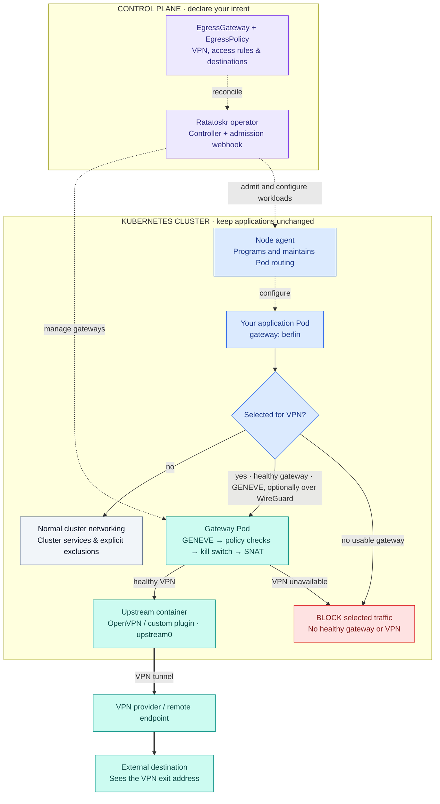

# Ratatoskr

### Kubernetes egress, through the VPN you choose.

Ratatoskr routes selected workload traffic through VPN-backed egress gateways.
Define a gateway, label your Pods, and let the operator manage the networking —
without putting a VPN client in every application.

**One label to opt in. Explicit policies when you need them. No unprotected
fallback for traffic selected for the gateway.**

- **VPN-backed egress:** use the included OpenVPN upstream or bring a container
  implementing the [upstream plugin contract](docs/adr/0006-upstream-plugin-contract.md).
- **Selective routing:** send all non-excluded traffic through a gateway, or
  select destinations and TCP/UDP ports with an `EgressPolicy`.
- **Fail-closed routing:** selected traffic is blocked when no usable gateway
  or VPN tunnel is available; it does not fall back to normal node egress.
- **Gateway pools:** run multiple replicas with stable per-Pod endpoint selection.
- **Optional in-cluster encryption:** wrap the workload-to-gateway GENEVE leg in
  WireGuard, independently of the upstream VPN.
- **Application-friendly defaults:** the node agent handles network programming;
  application containers do not need network-administration capabilities.

## How it works



*Solid arrows carry traffic; dotted arrows represent configuration. The diagram
shows the default node-agent driver. With the alternative init driver, an init
container programs the workload's network namespace instead.*

The Helm chart installs the controller, webhook, CRDs, and node agent. Creating
an `EgressGateway` then creates the gateway workloads. Each gateway Pod contains
Ratatoskr's datapath container and an upstream VPN container sharing one network
namespace. Cluster traffic and configured exclusions retain their direct path;
only selected traffic takes the tunnel. Cloud metadata access is blocked by
default, not forwarded through the VPN.

## Install with Helm

### Prerequisites

- A Kubernetes cluster **1.29 or newer**, with Linux worker nodes.
- Helm with OCI registry support, `kubectl`, and permission to install CRDs,
  cluster RBAC, admission webhooks, and the node-agent DaemonSet.
- Nodes with the required GENEVE, nftables, and TUN support; WireGuard support
  is also needed when enabling in-cluster encryption.
- Access to the node's CRI socket. The default is
  `/run/containerd/containerd.sock`; configure the actual path for your runtime.
- A VPN profile and any credentials required by your provider.

The default agent has host PID/network access and mounts the CRI socket; treat it
as **node-root-equivalent** and run it only on trusted nodes. Gateway VPN
containers also require network capabilities and access to `/dev/net/tun`.
Cluster security policy must allow these operator components; application Pods
are separate from this privilege boundary. See the [chart documentation](charts/ratatoskr/README.md)
for the detailed security model.

### 1. Install the operator

The release workflow publishes versioned charts to GHCR and matching images to
Docker Hub. Choose a version whose release has completed successfully; the
command below pins **0.1.0**. Use it once that version is available in the registry.

Create `ratatoskr-values.yaml`:

```yaml
driver: agent
datapath: iproute

agent:
  criSocket: /run/containerd/containerd.sock

exclusions:
  # Replace with your cluster's actual Service CIDR(s).
  serviceCIDRs:
    - 10.96.0.0/12
  # Usually discovered from Nodes; set explicitly if your CNI does not expose them.
  podCIDRs: []
```

Do not copy the example Service CIDR without checking your cluster. Exclusions
bypass the VPN, so adding overly broad ranges changes which traffic is protected.
For k3s/k3d, the CRI socket is typically `/run/k3s/containerd/containerd.sock`;
check your node configuration before installing.

```sh
export RATATOSKR_VERSION=0.1.0

helm upgrade --install ratatoskr oci://ghcr.io/jradikk/charts/ratatoskr \
  --version "$RATATOSKR_VERSION" \
  --namespace ratatoskr-system --create-namespace \
  --values ratatoskr-values.yaml \
  --wait --timeout 5m

kubectl get pods -n ratatoskr-system
```

If `operatorNamespace` is set, it must match the Helm release namespace. Keep
image versions aligned with the chart; published charts already select the
matching images. All options are listed in [values.yaml](charts/ratatoskr/values.yaml).

### 2. Add your VPN configuration

Create a Secret in the namespace where the gateway will live:

```sh
kubectl create secret generic berlin-vpn \
  --namespace ratatoskr-system \
  --from-file=client.ovpn=/path/to/client.ovpn
```

For username/password authentication, add
`--from-file=auth.txt=/path/to/auth.txt` to that command. `auth.txt` contains the
username and password on separate lines. Prefer an inline-certificate OpenVPN
profile; otherwise include every referenced certificate/key file in the same
Secret using its expected filename. See the [OpenVPN upstream guide](plugins/upstream/openvpn/README.md)
for profile constraints.

**Keep VPN profiles, credentials, and private keys out of Git and Helm values.**
The gateway references the Secret by name; configuration contents do not belong
in the custom resource.

### 3. Create a gateway

Save this as `gateway.yaml`:

```yaml
apiVersion: ratatoskr.skaldhall.io/v1alpha1
kind: EgressGateway
metadata:
  name: berlin
  namespace: ratatoskr-system
spec:
  replicas: 1
  upstream:
    type: openvpn
    secretRef:
      name: berlin-vpn
  encryption: none
  failMode: closed
  dns:
    mode: cluster
  allowedNamespaces:
    namespaceSelector:
      matchLabels:
        ratatoskr-access: berlin
```

```sh
kubectl apply -f gateway.yaml
kubectl wait --for=condition=Ready egressgateway/berlin \
  --namespace ratatoskr-system --timeout=180s
```

The namespace selector is an access allowlist. An omitted selector denies access;
an empty selector `{}` allows every namespace. Use a narrow selector and control
who can change namespace labels.

`encryption: none` disables only the **in-cluster WireGuard layer**; outbound
selected traffic still uses the OpenVPN tunnel. To encrypt both legs, use
`encryption: wireguard` with `datapath: iproute` and WireGuard-capable nodes.

### 4. Opt in an application

Authorize its namespace:

```sh
kubectl create namespace apps
kubectl label namespace apps ratatoskr-access=berlin
```

Add the gateway label to your Deployment's **Pod template**, before creating
its Pods:

```yaml
apiVersion: apps/v1
kind: Deployment
metadata:
  name: my-app
  namespace: apps
spec:
  replicas: 1
  selector:
    matchLabels:
      app: my-app
  template:
    metadata:
      labels:
        app: my-app
        ratatoskr.skaldhall.io/gateway: berlin
    spec:
      containers:
        - name: app
          image: your-registry/your-app:your-tag
```

Replace the application image with your own, then apply the manifest. By default,
gateway names resolve in the operator namespace. For a gateway elsewhere, add
`ratatoskr.skaldhall.io/gateway-namespace: <namespace>` to the Pod template labels.
When opting an existing application in, update its template and roll out new
Pods so admission can inject the required configuration.

Without an `EgressPolicy`, all non-excluded outbound traffic goes through the
selected gateway. Verify from your application that an external IP-reporting
endpoint sees the VPN exit address, while cluster services remain reachable.

## Route only selected traffic

Create an `EgressPolicy` in the **application namespace** to narrow the routing.
For example, this sends only TCP port 443 to the specified destination range
through `berlin`; other traffic keeps its normal route:

```yaml
apiVersion: ratatoskr.skaldhall.io/v1alpha1
kind: EgressPolicy
metadata:
  name: partner-api
  namespace: apps
spec:
  gatewayRef:
    name: berlin
    namespace: ratatoskr-system
  workloadSelector:
    matchLabels:
      app: my-app
  mode: include
  rules:
    - cidrs:
        - 203.0.113.0/24 # Documentation range: replace with your destination CIDR.
      ports:
        - protocol: TCP
          port: 443
```

`mode: include` tunnels matching traffic; `mode: exclude` tunnels traffic except
matches. Cluster and explicit exclusions take precedence in either mode.
Avoid overlapping policies selecting the same Pod. Rules use IP ranges and
TCP/UDP ports, not hostnames. See the [API and routing design](docs/design.md#3-api)
for full semantics.

## Configuration at a glance

| Setting | Default | Purpose |
| --- | --- | --- |
| Helm `driver` | `agent` | Node agent maintains routing; `init` programs it at Pod startup. |
| Helm `datapath` | `iproute` | Linux policy routing; `ebpf` is an opt-in alternative requiring additional node support. |
| Gateway `replicas` | `1` | Pool size; endpoint selection is sticky per Pod, not per request. |
| Gateway `encryption` | `none` | Set `wireguard` for the workload-to-gateway leg; separate from the upstream VPN. |
| Gateway `dns.mode` | `cluster` | Set `gateway` for external DNS through the VPN; cluster names retain cluster resolution. |
| Gateway `failMode` | `closed` | The only accepted mode; no unprotected fallback for selected traffic. |

The included upstream image supports **OpenVPN**. The API also reserves
WireGuard, AmneziaWG, and strongSwan upstream types; those names do not mean
bundled implementations are available. Custom upstreams must satisfy the plugin
contract. The `ebpf` datapath does **not** support the optional WireGuard
in-cluster layer; use `iproute` for that combination. Selected egress currently
targets IPv4; IPv6 VPN routing is not supported.

## Operations

Inspect gateway readiness and recent operator events:

```sh
kubectl get egressgateways -A
kubectl describe egressgateway berlin -n ratatoskr-system
kubectl get events -n ratatoskr-system --sort-by=.metadata.creationTimestamp
kubectl logs -n ratatoskr-system deployment/ratatoskr-controller
```

If a gateway does not become ready, check the VPN Secret's filenames, provider
connectivity, TUN permissions, and gateway Pod logs. If an application is refused
or waits at startup, check its namespace access labels, gateway readiness, and
node-agent logs. Do not bypass readiness or disable fail-closed protections to
make a workload start.

For multiple controller replicas, enable leader election alongside the replica
count. Webhook replicas can also be increased:

```yaml
controller:
  replicas: 2
  leaderElection:
    enabled: true
webhook:
  replicas: 2
```

Before upgrading, review release notes and CRD schema changes. **Helm installs
CRDs on first install but does not automatically upgrade or delete them.**
Re-run the installation command with the chosen version after handling any
required CRD migration separately.

To retire Ratatoskr, first remove gateway labels/policies from workload templates
and replace affected Pods, then delete gateway resources and their VPN Secrets
when no longer used. Only then uninstall the operator:

```sh
helm uninstall ratatoskr --namespace ratatoskr-system
```

CRDs and their lifecycle require separate administration; do not remove them
while resources or workloads still depend on Ratatoskr.

## License

Ratatoskr is licensed under [Apache-2.0](LICENSE).

## Contributing

Contributions, bug reports, and improvements to upstream integrations are welcome.
See [CONTRIBUTING.md](CONTRIBUTING.md) for the development environment, test
commands, and review process. The [architecture guide](docs/design.md) explains
component responsibilities and routing, and the [security policy](SECURITY.md)
describes trust boundaries and vulnerability reporting.
